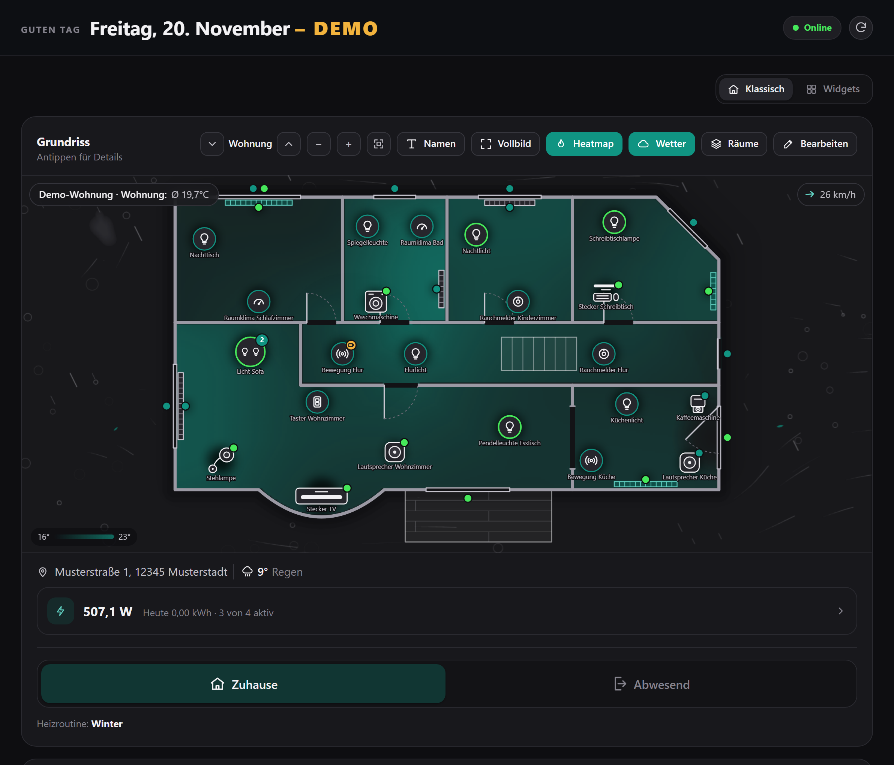
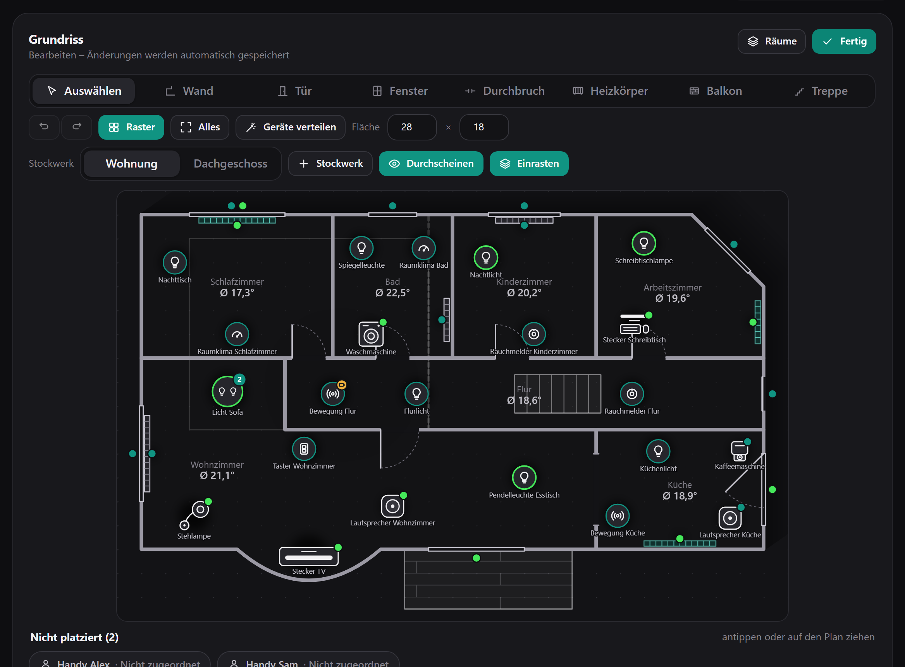
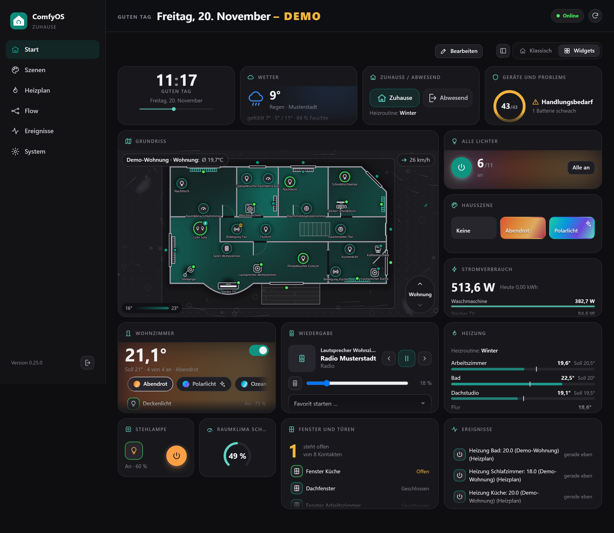
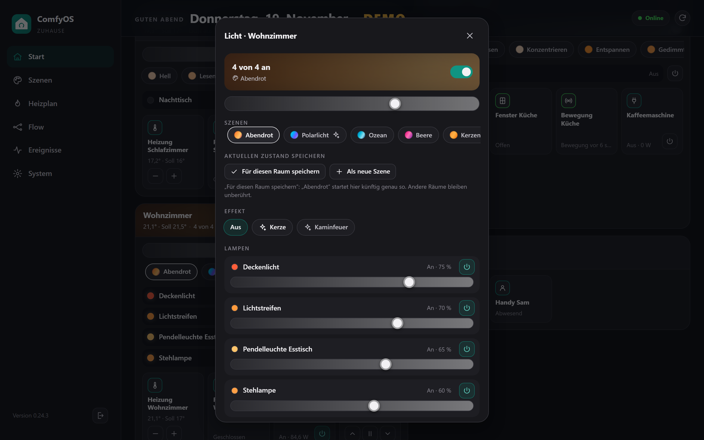
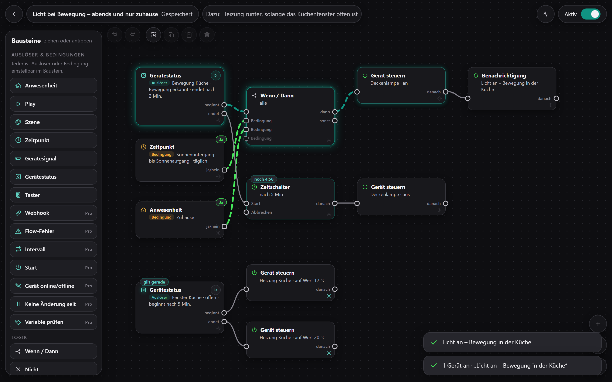
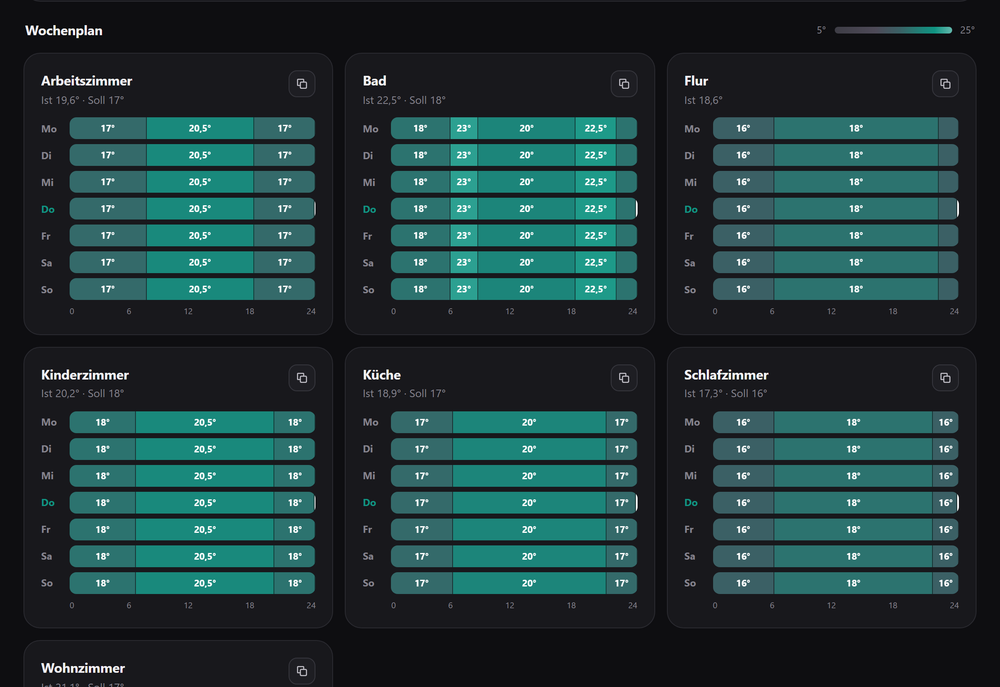
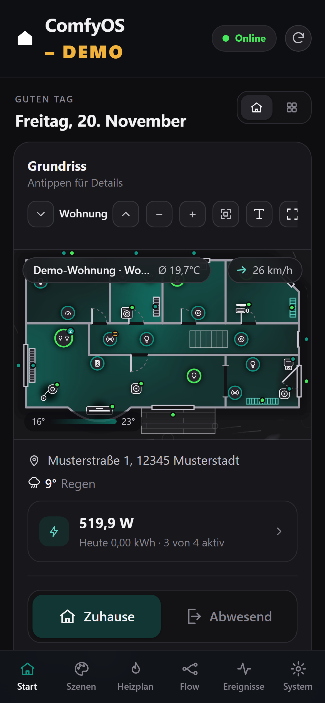

# ComfyOS

**Die lokale Smart-Home-Zentrale mit Grundriss.** ComfyOS bringt Philips Hue, FRITZ!Box, die Magenta SmartHome Home Base, Zigbee2MQTT, Matter und Sonos in eine Oberfläche. Alles läuft im eigenen Heimnetz, ohne Cloud-Konto und ohne Konfigurationsdateien.



> Privates Community-Projekt, nicht mit der Deutschen Telekom verbunden. „Magenta“ und „QIVICON“ sind Marken ihrer jeweiligen Inhaber.

## Was ist ComfyOS?

ComfyOS ist eine Web-App, die dauerhaft auf einem Raspberry Pi oder einem Rechner im Heimnetz läuft. Du öffnest sie im Browser auf dem Handy, dem Tablet an der Wand oder am PC. Sie zeigt dein Zuhause als Grundriss: Räume mit ihrer Temperatur, Lampen, Fenster, Heizkörper und Lautsprecher dort, wo sie wirklich sind. Von hier aus schaltest du, legst Szenen und Heizpläne an und baust Automationen.

Jede Geräteanbindung ist ein **Plugin**. ComfyOS läuft mit jeder Kombination, mit einer Hue Bridge allein genauso wie mit Home Base, FRITZ!Box und Zigbee2MQTT zusammen.

## Warum es ComfyOS gibt

Ein Smart Home wächst selten aus einem Guss. Typisch ist eine Mischung, die über die Jahre zusammenkommt: eine Home Base der Telekom, eine Hue Bridge, eine FRITZ!Box mit DECT-Steckdosen, ein Sonos-Lautsprecher. Das Ergebnis kennen viele:

- **Jedes System hat seine eigene App.** Licht steuerst du in der Hue-App, die Heizung in der Magenta-App, die Steckdose in der FRITZ!App. Automationen über Herstellergrenzen hinweg gehen nicht.
- **Vieles hängt an der Cloud.** Fällt das Internet oder der Dienst des Herstellers aus, ist auch das Zuhause eingeschränkt. Und jede Lampe meldet ihren Zustand an fremde Server.
- **Die offenen Alternativen sind mächtig, aber aufwendig.** Home Assistant und openHAB können fast alles. Sie verlangen aber Zeit, Einarbeitung und oft Konfigurationsdateien. Wer einfach sein Zuhause steuern will, sucht etwas Überschaubares.
- **Der Überblick fehlt.** Welches Fenster ist offen, welcher Raum ist kalt, welche Batterie ist leer? Eine Liste mit 40 Geräten beantwortet das schlechter als ein Blick auf den Grundriss.

ComfyOS setzt genau dort an: **eine Oberfläche für alle Geräte, lokal, mit dem Grundriss im Mittelpunkt**. Eingerichtet wird mit ein paar Klicks statt mit YAML. ComfyOS spricht direkt mit Bridges und Geräten im Heimnetz und schickt ohne deine Zustimmung nichts ins Internet. Ältere Tablets taugen weiter als Wanddisplay, und Alexa, Apple Home oder Google Home steuern deine Geräte über Matter, ohne Skill und ohne Konto.

## Was ComfyOS kann

### Der Grundriss als Zentrale

Du zeichnest nur Wände, gerade, schräg oder als Bogen. Jede geschlossene Fläche wird automatisch ein Raum. Türen, Fenster und Heizkörper ziehst du auf die Wände, Fensterkontakte und Thermostate docken daran an. Danach zeigt der Plan auf einen Blick, was an ist, was offen steht und wo eine Batterie schwächelt. Die Heatmap lässt Heizkörper nach gemessener Temperatur leuchten. Rund ums Haus erscheint das aktuelle Wetter: Regen, Wind, Schnee und Sonnenstand. Ein Haus mit Keller, Obergeschoss oder Dach zeichnest du als mehrere **Stockwerke** und wechselst mit zwei Knöpfen oder über die Treppen im Plan zwischen ihnen; Balkone und Terrassen liegen außen, der Regen fällt auch auf sie.



### Startseite nach Wunsch

Die klassische Startseite zeigt Grundriss, Szenen, Kennzahlen und Raumkarten. In der **Widget-Ansicht** stellst du sie dir aus 21 Widgets selbst zusammen: Uhr, Wetter, Heizung, Stromverbrauch, einzelne Geräte, Szenen-Tasten und mehr. Handy und großer Bildschirm haben je eine eigene Anordnung.



### Licht und Szenen

Szenen sind Farbpaletten, die ComfyOS auf die Lampen eines Raums verteilt. Eine Szene legst du einmal an und ordnest sie Räumen zu. Pro Raum lässt sie sich abwandeln und speichern. Effekte wie Kerze oder Kaminfeuer laufen unabhängig davon. Paletten entstehen auf Wunsch aus einem Foto, das dabei dein Gerät nicht verlässt.



### Automationen mit Flow

Im Flow-Editor steckst du Abläufe aus Bausteinen zusammen: Auslöser, Bedingungen, Aktionen. Ein Baustein wie „Bewegung“ kennt Anfang und Ende. „Licht an, solange jemand im Raum ist“ ist deshalb ein einziger Baustein mit zwei Ausgängen. Beim Testen leuchtet der Weg auf, den ein Durchlauf nimmt.



### Heizplan

Wochenpläne je Raum als Zeitleisten, mehrere Heizroutinen (etwa „Winter“ und „Urlaub“) und der Wechsel bei Zuhause/Abwesend. ComfyOS führt den Plan selbst aus, egal ob die Thermostate an der FRITZ!Box, an Zigbee2MQTT oder an der Home Base hängen.



### Auch unterwegs und auf alten Geräten



ComfyOS lässt sich als App zum Home-Bildschirm hinzufügen. Es läuft auch auf älteren iPads ab iPadOS 13 und passt die Darstellung an, wenn ein Gerät nicht mitkommt. Von unterwegs erreichst du es über ein VPN ins Heimnetz, nie über eine offene Portfreigabe.

Außerdem dabei: Gerätesperre, Stromverbrauch je Gerät, Temperatur- und Heizverlauf, amtliche Wetterwarnungen des DWD mit Hinweis auf offene Fenster, Push-Benachrichtigungen, Backup und Umzugspaket, Updates per Klick und eine **Demo-Wohnung** zum Ausprobieren, ganz ohne eigene Geräte.

<br clear="right">

## Was sich anbinden lässt

| Plugin | Was es bringt | Verbindung |
|---|---|---|
| **Philips Hue** | Lampen mit Farbe und Verläufen, Steckdosen, Bewegungsmelder, Schalter | Hue Bridge, lokale API, live |
| **FRITZ!Box** | FRITZ!DECT-Steckdosen, Heizkörperregler, Lampen, Taster, Anwesenheit | FRITZ!Box im Heimnetz |
| **Home Base** | Alles, was die Magenta SmartHome Home Base 2 (QIVICON) kennt, plus Anlernen neuer Geräte | Home Base im Heimnetz, kein Telekom-Konto nötig |
| **MQTT** | Zigbee2MQTT, Tasmota, ESPHome und eigene Geräte | MQTT-Broker im Heimnetz |
| **Matter** | Deine Geräte in Alexa, Apple Home und Google Home, umgekehrt Matter-Geräte in ComfyOS | lokal, ohne Skill und Konto |
| **Sonos** | Wiedergabe, Lautstärke, Favoriten, Gruppen, Ton des PCs auf dem Lautsprecher | lokal, ohne Sonos-Konto |
| **Netzwerk** | Anwesenheit: „Handy im WLAN“ | Erreichbarkeit im Heimnetz |

Eigene Plugins sind ein Ordner mit einem Manifest und etwas Python. Wie das geht, steht im [Wiki](docs/wiki/21-plugins-entwickeln.md).

## Installation

ComfyOS braucht Python 3.10 oder neuer und einen Rechner, der im Heimnetz dauerhaft läuft. Das Paket `comfyos.zip` liegt immer beim [neuesten Release](https://github.com/BoostedMoose/ComfyOS/releases/latest).

### Raspberry Pi (empfohlen)

Auf dem Pi anmelden und diese vier Zeilen ausführen:

```
wget https://github.com/BoostedMoose/ComfyOS/releases/latest/download/comfyos.zip
unzip comfyos.zip
cd comfyos
sudo bash install_pi.sh
```

Das Skript richtet ComfyOS als Dienst ein, der nach jedem Neustart von selbst läuft. Danach öffnest du `http://comfyos/` im Browser. Der Ordner `comfyos` ist die Installation und bleibt, wo er ist.

### Windows

`comfyos.zip` herunterladen, entpacken und im Ordner `comfyos` die Datei `start.bat` doppelt anklicken. Fehlt Python, installiert der Startassistent es. ComfyOS läuft, solange das Fenster offen ist, unter `http://localhost:8000/`.

### Linux und macOS

`comfyos.zip` entpacken und im Ordner `comfyos` `bash start.sh` ausführen. ComfyOS läuft dann unter `http://localhost:8000/`.

### Danach

Beim ersten Aufruf legst du ein Passwort fest. Wie es weitergeht, steht unter [Erste Schritte](docs/wiki/01-erste-schritte.md).

**Updates** installierst du in ComfyOS selbst: *System → Update → Nach Updates suchen*. ComfyOS legt vorher eine Sicherung an und kehrt zur alten Version zurück, wenn etwas schiefgeht. Deine Daten und Einstellungen bleiben erhalten.

## Datenschutz

ComfyOS sendet keine Telemetrie, keine Statistik und keine Absturzberichte. Eine frische Installation baut keine einzige Verbindung ins Internet auf. Nur Funktionen, die du einschaltest, verlassen das Heimnetz, etwa das Wetter. Jede davon steht mit Ziel und gesendeten Daten unter *System → Externe Verbindungen*. Die vollständige Liste steht im [Wiki](docs/wiki/10-sicherheit-und-datenschutz.md).

## Projektstand

Aktuell ist **Version 0.26**. ComfyOS läuft täglich in einem echten Zuhause mit Home Base, Hue, FRITZ!Box und Sonos. Was dort noch nicht nachgeprüft werden konnte, ist als offen vermerkt, zum Beispiel Zigbee2MQTT-Geräte und Matter am Echo.

Als Nächstes folgt ein Docker-Image mit Installation per Einzeiler. Bis Version 1.0 ist ComfyOS eine Vorabversion für erste Tester.

## Dokumentation

Das [Wiki](docs/wiki/README.md) erklärt Schritt für Schritt, wie du ComfyOS einrichtest und nutzt.

| Für Nutzer | Für Entwickler |
|---|---|
| [Erste Schritte](docs/wiki/01-erste-schritte.md) | [Architektur](docs/wiki/20-architektur.md) |
| [Plugins einrichten](docs/wiki/03-plugins.md) | [Plugins entwickeln](docs/wiki/21-plugins-entwickeln.md) |
| [Grundriss](docs/wiki/05-grundriss.md) | [Mitentwickeln und Tests](docs/wiki/22-mitentwickeln.md) |
| [Flow](docs/wiki/07-flow.md) | |
| [Fernzugriff per VPN](docs/wiki/09-fernzugriff-vpn.md) | |
| [Fehlerbehebung](docs/wiki/13-fehlerbehebung.md) | |

## Technik in Kürze

Python mit FastAPI im Backend, eine Oberfläche aus reinem JavaScript und CSS, die Daten als JSON-Dateien. Kein Build-Schritt, keine Datenbank, keine Fremdinhalte im Browser. Mehr dazu unter [Architektur](docs/wiki/20-architektur.md).


## Basic und Pro

**ComfyOS ist kostenlos.** Basic ist keine Probeversion und hat kein Zeitlimit: alle Plugins, Grundriss, Szenen, Heizpläne, Flows, Widgets, Stromverbrauch und Backups. Wer sein Zuhause mit ComfyOS steuern will, braucht kein Pro.

Pro gibt es, weil die Entwicklung Zeit und Geld kostet: Jede neue Funktion muss getestet werden, benötigt eventuell neue Hardware etc. Mit Pro unterstützt du die Weiterentwicklung direkt und hältst sie am Laufen. Als Dank dafür gibt es:

- **Zusätzliche Flow-Bausteine** wie Schleifen, Variablen und Push-Benachrichtigungen.
- **Mehr Möglichkeiten im Grundriss:** beliebig viele Räume und Etagen, Fenster und Heizkörper, Heatmap und Wettereffekte.
- **Ein paar Extras:** unbegrenzt aktive Flows, Verläufe über 31 Tage, Energieauswertung je Gerät, mehrere Widget-Seiten und eine eigene Akzentfarbe.

Pro ist eine LIFETIME Lizenz. Keine Abos, keine wiederkehrenden Kosten. Die vollständige Gegenüberstellung steht unter [Basic und Pro](docs/wiki/12-basic-und-pro.md).

## Lizenz

Die mitgelieferten Plugins und das Plugin-SDK (`public/`) stehen unter der Apache-2.0-Lizenz. Für ComfyOS selbst gilt eine eigene Lizenz. Beide Lizenztexte kommen mit dem öffentlichen Repository.
