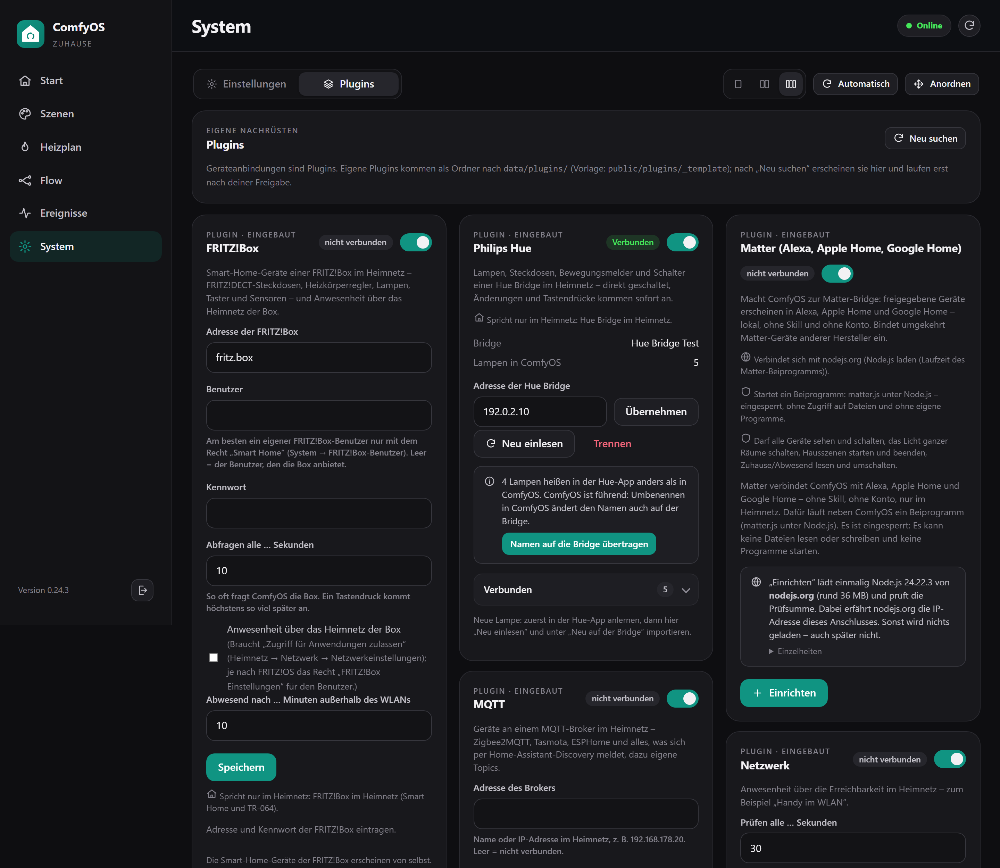

# Plugins einrichten

Alle Plugins findest du unter *System → Plugins*. Jede Kachel zeigt Zustand, Schalter und Einstellungen. Ein ausgeschaltetes Plugin zählt nicht mit, und ein fehlerhaftes legt den Rest nicht lahm.

**Allgemein gilt:**

- Zugangsdaten gehen nur an Adressen im Heimnetz. Änderst du die Adresse, musst du das Passwort neu eingeben.
- Nach einer abgelehnten Anmeldung wartet ComfyOS, statt es weiter zu versuchen. So sperrt sich kein Konto.
- Gibt es dasselbe Gerät in zwei Plugins (etwa eine Hue-Lampe in der Home Base und an der Bridge), zeigt ComfyOS es nur einmal.

**Übersicht:** [Philips Hue](#philips-hue) · [FRITZ!Box](#fritzbox) · [Home Base](#home-base-magenta-smarthome) · [MQTT](#mqtt-zigbee2mqtt-tasmota-esphome) · [Matter](#matter-alexa-apple-home-google-home) · [Sonos](#sonos) · [Netzwerk](#netzwerk-anwesenheit) · [Eigene Plugins](#eigene-plugins)

---

## Philips Hue

Lampen mit Helligkeit, Weißton, Farbe, Verläufen und Effekten, Steckdosen, Bewegungsmelder mit Temperatur und Umgebungslicht, Schalter (Dimmschalter, Tap Dial, Smart Button, Wandschalter-Modul). Änderungen aus der Hue-App kommen sofort an.

1. In der Kachel **Philips Hue** die Adresse der Bridge eintragen (eine verbundene Home Base schlägt sie vor) und **Verbinden** tippen.
2. Die runde Link-Taste oben auf der Bridge drücken, wenn die Kachel darum bittet.
3. Neue Geräte unter „Neu auf der Bridge“ mit Raum übernehmen.

**Gut zu wissen:** ComfyOS ist führend bei den Namen und überträgt sie auf die Bridge. Szenen der Bridge lassen sich unter *Szenen → Import* als Palette übernehmen. Die Hue-Cloud wird nie benutzt.

## FRITZ!Box

FRITZ!DECT-Steckdosen mit Verbrauch, Heizkörperregler, Lampen, Rollläden, Kontakte, Temperatur und Luftfeuchte. Die Taster FRITZ!DECT 400 und 440 starten Flows. Auf Wunsch meldet die Box, welche Handys im WLAN sind.

1. In der FRITZ!Box einen eigenen Benutzer anlegen, nur mit dem Recht **Smart Home** (*System → FRITZ!Box-Benutzer*).
2. In der Kachel **FRITZ!Box** Adresse (Vorgabe `fritz.box`), Benutzer und Kennwort eintragen.
3. Für Anwesenheit: In der Box *Heimnetz → Netzwerk → Netzwerkeinstellungen → Zugriff für Anwendungen zulassen* einschalten. Dann in der Kachel **Geräte im Heimnetz laden**, die Handys ankreuzen, speichern.

**Gut zu wissen:** ComfyOS fragt die Box alle 10 Sekunden ab (einstellbar). Ein Tastendruck kommt also bis zu zehn Sekunden später an. Das Kennwort verlässt die Box nie im Klartext.

## Home Base (Magenta SmartHome)

Alles, was die Home Base 2 (QIVICON) verwaltet: Thermostate, Zwischenstecker, Lampen, Rollläden, Fenster-, Bewegungs- und Rauchmelder. Dazu das Anlernen neuer Geräte mit Anleitung je Hersteller.

1. In der Kachel **Home Base** die Adresse (`https://qivicon` oder die IP) und das Passwort der QIVICON-Weboberfläche eintragen.
2. **Verbinden & speichern.** Ein Telekom-Konto ist dafür nicht nötig.
3. Optional den **Magenta-Sync** einrichten (Telekom-Login): Er übernimmt Heizroutinen und Zuhause/Abwesend aus der Magenta-App und hält beides abgestimmt. Gedacht für einen sanften Umstieg.

**Gut zu wissen:** Der Grundriss ist führend. Räume, Umbenennungen und Zuordnungen schreibt ComfyOS in die Home Base, die Magenta-App zeigt sie dann ebenso. Lampen der Home Base lassen sich nur an- und ausschalten. Hue-Lampen laufen mit Farbe über das Hue-Plugin.

## MQTT (Zigbee2MQTT, Tasmota, ESPHome)

ComfyOS meldet sich als Client am Broker an und findet Geräte auf drei Wegen von selbst: Home-Assistant-Discovery (ESPHome und viele andere), die Geräteliste von Zigbee2MQTT und die Discovery von Tasmota.

1. In der Kachel **MQTT** Adresse und Port des Brokers eintragen (meist `1883`, mit TLS `8883`), bei Bedarf Benutzer und Passwort.
2. Bei Zigbee2MQTT mit anderem Basis-Topic als `zigbee2mqtt` dieses eintragen.
3. Gefundene Geräte unter „Neu gefunden“ einzeln oder alle übernehmen.

Geräte ohne Discovery (Shelly, eigene Skripte) legst du mit **Eigenes Gerät anlegen** über ihre Topics an.

**Gut zu wissen:** Fernbedienungen von Zigbee2MQTT sind Taster und starten Flows. Schlösser, Betriebsarten und einstellbare Zahlen stehen im Gerätedialog unter „Weitere Funktionen“. Vorlagen aus Discovery-Nachrichten werden nie ausgeführt – was ComfyOS nicht lesen kann, steht als „Nicht unterstützt“ in der Kachel.

## Matter (Alexa, Apple Home, Google Home)

ComfyOS wird zur Matter-Bridge: Deine Geräte erscheinen in Alexa, Apple Home und Google Home – egal, über welches Plugin sie kommen. Umgekehrt holst du Matter-Geräte anderer Hersteller in ComfyOS.

1. In der Kachel **Matter** auf **Einrichten** tippen. ComfyOS lädt dafür einmalig Node.js von nodejs.org (rund 36 MB, die Prüfsumme wird kontrolliert). Braucht ein 64-Bit-System.
2. Unter **Für Matter sichtbar** wählen, was die Sprachassistenten sehen sollen: einzelne Geräte, einen Raum, eine Gruppe oder alles. Auch „Wohnzimmer Licht“, „Alle Lichter“, Hausszenen und „Zuhause“ lassen sich freigeben.
3. **Kopplung öffnen** und den Code oder QR-Code in der Alexa-, Home- oder Google-Home-App eingeben („Gerät hinzufügen → Matter“).

**Gut zu wissen:** Kein Skill, kein Konto, keine Portfreigabe. Ein gesperrtes Gerät lässt sich auch per Sprache nicht schalten. Die Bridge ist nicht zertifiziert, die Apps zeigen beim Koppeln einen Hinweis, und einzelne Echo-Modelle lehnen solche Bridges ab. Nach einem Umzug auf neue Hardware muss neu gekoppelt werden.

## Sonos

Ein Gerät je Raum mit Wiedergabe, Lautstärke, Stumm, Titel und Titelbild. Favoriten starten, Räume gruppieren, den Ton des PCs auf den Lautsprecher schicken.

1. In der Sonos-App prüfen: *Konto → Datenschutz & Sicherheit → UPnP* ist an (Vorgabe).
2. In der Kachel **Sonos** auf **Lautsprecher suchen** tippen, oder die Adresse eines Lautsprechers eintragen. Einer genügt, er kennt den ganzen Haushalt.
3. Räume unter „Neu bei Sonos“ übernehmen.

**Ton dieses Rechners:** Das Sende-Symbol auf der Lautsprecherkachel spielt den Ton des PCs auf dem Lautsprecher, einige Sekunden verzögert. Das geht mit Chrome oder Edge am Rechner, wenn ComfyOS über HTTPS geöffnet ist. Wichtig: Während einer Übertragung kann jeder im Heimnetz mithören.

## Netzwerk (Anwesenheit)

Zeigt, ob ein Gerät im Heimnetz erreichbar ist. Typisch: „Handy im WLAN“ heißt „jemand ist zu Hause“.

1. Dem Handy im Router eine feste Adresse geben.
2. In der Kachel **Netzwerk** Name, Adresse und Port eintragen (beim iPhone meist `62078`).
3. **Jetzt prüfen** zeigt, ob das Gerät antwortet.

**Gut zu wissen:** Handys schlafen. Als abwesend gilt ein Gerät deshalb erst nach einer einstellbaren Zeit ohne Antwort (Vorgabe 10 Minuten). Mit FRITZ!Box ist deren Anwesenheit zuverlässiger.

## Eigene Plugins

Eigene Plugins kommen als Ordner nach `data/plugins/`. Nach **Neu suchen** erscheinen sie als Kachel und laufen erst nach deiner Freigabe mit Passwort. Braucht ein Plugin Zugriff auf alle Geräte oder ein eigenes Beiprogramm, nennt die Freigabe-Rückfrage das im Klartext. Anleitung: [Plugins entwickeln](21-plugins-entwickeln.md).
