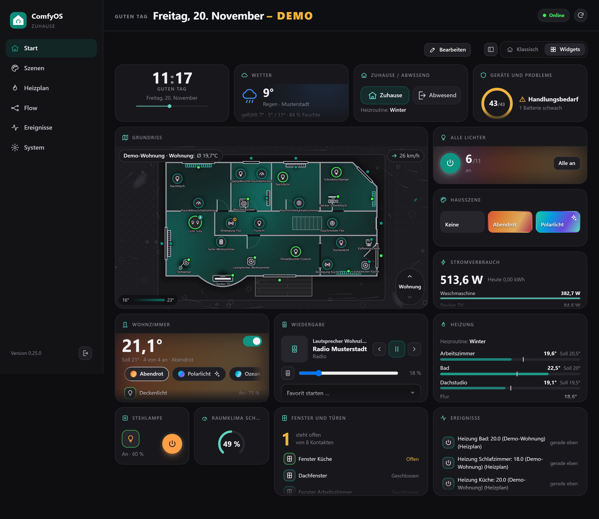

# Startseite und Widgets

Die Startseite gibt es in zwei Ansichten. Oben schaltest du zwischen **Klassisch** und **Widgets** um. Jedes Gerät merkt sich die Wahl: Das Wand-Tablet kann Widgets zeigen, während das Handy klassisch bleibt.

## Klassische Ansicht

Von oben nach unten:

1. **Grundriss** mit Adresse, Wetter und Wetterwarnung, darunter Stromverbrauch und der Schalter **Zuhause/Abwesend**.
2. **Licht & Szenen:** eine Szene fürs ganze Haus, „Alle Lichter an/aus“.
3. **Kennzahlen:** Geräte online mit Gesamtstatus, Durchschnittstemperatur, offene Fenster, schwache Batterien.
4. **Wiedergabe:** eine Kachel je Lautsprecher.
5. **Raumkarten:** je Raum Temperatur, Lichtschalter, Helligkeit, Szenen, jede Lampe als Zeile und die übrigen Geräte als kleine Kacheln. Im Hintergrund leuchtet das aktuelle Licht des Raums.

Tippst du auf den Kopf einer Raumkarte, öffnet sich die Lichteinstellung des Raums (siehe [Licht und Szenen](06-licht-und-szenen.md)). Raumkarten stehen am großen Bildschirm in 1, 2 oder 3 Spalten. Mit **Anordnen** ziehst du sie an ihren Platz – die Reihenfolge gilt dann auf allen Geräten.

## Widget-Ansicht

Hier stellst du die Seite selbst zusammen. Widgets liegen frei auf einem Raster, in jeder Größe.

| Gruppe | Widgets |
|---|---|
| Übersicht | Uhr, Grundriss, Raum, Geräte und Probleme, Fenster und Türen, Anwesenheit, Ereignisse, Verbindungen |
| Daten | Wetter, Messwert (Zahl, Rundanzeige oder Balken), Stromverbrauch, Heizung |
| Aktionen | Zuhause/Abwesend, Licht, Hausszene, Szenen-Schnellwahl, Gerät, Flow-Knopf, Wiedergabe |
| Gestaltung | Notiz, Überschrift |

**So bearbeitest du die Seite:**

- **Bearbeiten** blendet das Raster ein. Widgets am Griff ziehen, an der Ecke die Größe ändern, auf freies Raster tippen zum Hinzufügen. Die anderen Widgets machen Platz, **Rückgängig** nimmt Schritte zurück.
- Jedes Widget hat Einstellungen für Inhalt, Titel, Stil (Kachel, Glas, Akzent, ohne Rahmen), Farbakzent und Ausrichtung.
- Je Seite wählst du Spaltenzahl, Zeilenhöhe, Abstand und Hintergrund.
- **Mit Vorschlag starten** legt eine erste Seite an, die zu deinem Zuhause passt.

**Handy und großer Bildschirm** haben je eine eigene Anordnung. Ohne eigene Handy-Anordnung leitet ComfyOS sie von der breiten ab. Am großen Bildschirm blendet der Knopf links neben dem Umschalter die Seitenleiste aus.

Widgets finden ihre Geräte über das, was diese können. Ein neu eingerichtetes Plugin taucht deshalb von selbst in den passenden Widgets auf.

## Kopfzeile auf jeder Seite

Oben rechts steht der Zustand aller eingeschalteten Plugins: **Online**, **Verbindet** (kurz nach dem Start) oder **Fehler**. Fährst du mit der Maus darüber, siehst du, welche Dienste dazugehören. Daneben lädt **Aktualisieren** die Seite neu.
