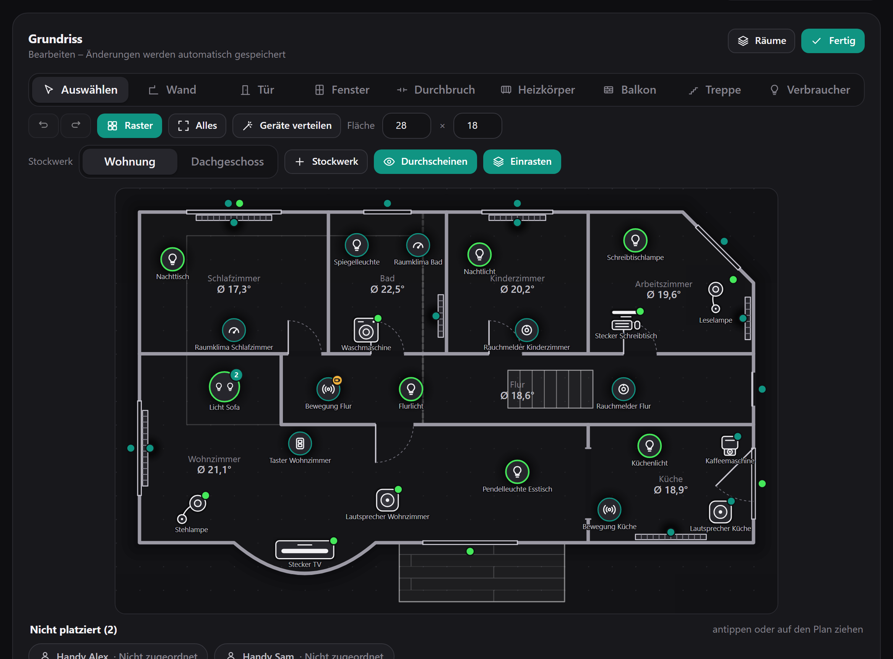
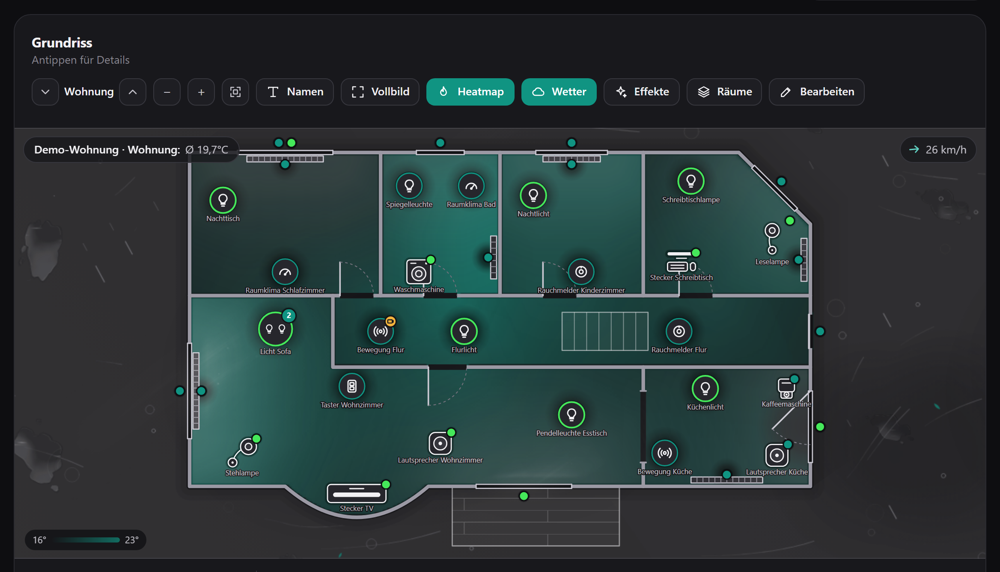

# Grundriss

Der Grundriss ist das Herz von ComfyOS. Er zeigt, wo was ist, und er bestimmt die Räume.

## Zeichnen

Tippe im Grundriss auf **Bearbeiten**. Änderungen werden sofort gespeichert.

| Werkzeug | So geht’s |
|---|---|
| **Wand** | Punkt für Punkt zeichnen. Jede rundum geschlossene Fläche wird ein Raum. Eine Wand auswählen und die Mitte ziehen macht einen Bogen. Ein Rechtsklick bricht das Zeichnen ab; im Dialog „Raum benennen“ entfernt **Abbrechen** den gerade gezeichneten Raum wieder. |
| **Tür, Fenster** | Auf eine Wand ziehen. Türen und Fenster lassen sich spiegeln und auf die andere Wandseite setzen. |
| **Durchbruch** | Eine Öffnung ohne Tür, etwa zwischen Küche und Wohnzimmer. |
| **Heizkörper** | Auf eine Wand ziehen, dann ein Thermostat daraufziehen. |
| **Treppe** | Von der untersten zur obersten Stufe ziehen. Breite und Richtung lassen sich danach ändern. |
| **Balkon** | Balkon oder Terrasse: Ecke für Ecke antippen, der erste Punkt schließt die Fläche. Sie liegt außen – Regen und Schnee fallen auch darauf. Als Boden wählst du Holz, Fliesen oder glatt. |
| **Verbraucher** | Ein Gerät ohne eigene Steuerung, etwa die Stehlampe am Zwischenstecker, die Lichterkette oder das Radio: antippen, wo es steht, dann Art und das Gerät wählen, an dem es hängt. Siehe [Verbraucher](#verbraucher). |
| **Auswählen** | Antippen bearbeitet. Rahmen aufziehen, Umschalt- oder Strg-Klick und **Alles** (Strg+A) wählen mehrere Teile – dann gemeinsam verschieben oder skalieren. |
| **Raster** | Einrasten am Raster an- und abschalten. An Wandecken rastet der Editor immer ein. |

**Fläche** legt die Größe der Zeichenfläche in Kästchen fest. Wie groß ein Kästchen ist, bestimmst du selbst – etwa ein halber Meter.

## Verbraucher

Nicht alles im Haus ist smart. Die Stehlampe hängt am Zwischenstecker, die Lichterkette am Schaltaktor, das alte Radio an der Steckdosenleiste. Mit dem Werkzeug **Verbraucher** stellst du solche Geräte dorthin, wo sie wirklich stehen. Sie machen den Grundriss realistischer und sind nur für das Bild da: In Listen, Szenen und Flows erscheinen sie nicht.

- **Verknüpfen:** Unter „Hängt an“ wählst du das Gerät, das ComfyOS schaltet. Ist es an, ist auch der Verbraucher an. Hängen drei Lampen am selben Stecker, leuchten alle drei.
- **Arten:** Lampe, Lichterkette und Kerzen leuchten mit einstellbarer Helligkeit – in einem Weißton von Kerzenlicht bis Kaltweiß oder in einer eigenen Farbe. Eine Lichterkette funkelt, Kerzen und Kamin flackern, Radio und Fernseher senden Schallwellen. Ventilator, Heizgerät und andere Geräte zeigen nur an oder aus.
- **Aussehen:** als Blase mit einem Zeichen deiner Wahl – Glühbirne, Stecker, Lautsprecher, Flamme und andere – oder mit einem Symbol in Draufsicht (Pro), das sich frei drehen und skalieren lässt. Das Leuchten zeigt die Ansicht mit eingeschalteten **Effekten**.
- **In der Ansicht** öffnet Antippen das Gerät, an dem der Verbraucher hängt – dort schaltest du ihn.

## Stockwerke

Ein Haus mit Keller, Obergeschoss oder Dach zeichnest du als mehrere Stockwerke. Gezeigt und bearbeitet wird immer eines.

- **Anlegen:** Im Editor **+ Stockwerk** antippen, die Lage wählen (ganz oben oder ganz unten) und entscheiden, ob der Grundriss des gezeigten Stockwerks übernommen wird oder du leer anfängst. Übernommen werden Wände, Türen, Fenster, Heizkörper und Balkone, keine Geräte.
- **Orientierung:** Beim Zeichnen scheint das Stockwerk darunter gestrichelt durch, und neue Punkte rasten an seinen Wänden ein. **Durchscheinen** und **Einrasten** schalten beides ab.
- **Wechseln:** Im Editor über die Leiste **Stockwerk**, sonst mit den zwei Pfeilen über dem Plan und im Vollbild. Jedes Gerät merkt sich, welches Stockwerk es zuletzt gezeigt hat – ein Tablet im Obergeschoss bleibt dort.
- **Treppen:** Eine Treppe erscheint im Stockwerk darüber von selbst als Abgang – mit Schatten, der nach unten tiefer wird. Antippen wechselt das Stockwerk: die Treppe führt nach oben, der Abgang nach unten. Treppen dürfen übereinander liegen wie in einem Treppenhaus; dann teilen sich Aufgang und Abgang die Fläche.
- **Name und Löschen:** Stehen im Editor rechts, solange nichts ausgewählt ist. Die Geräte eines gelöschten Stockwerks sind wieder unplatziert.
- **Geräte:** Ein Gerät steht immer nur auf einem Stockwerk. Zum Umziehen das Gerät im Editor antippen und unter **Stockwerk** ein anderes wählen.
- **Widget:** Das Grundriss-Widget wechselt das Stockwerk mit Knöpfen im Widget – oder zeigt ein festes. Für die ganze Übersicht legst du je Stockwerk ein Widget an.

Ein Keller zeigt kein Wetter. Weitere Stockwerke gehören zu Pro, Balkone und Terrassen zu Basic.

## Geräte platzieren

- Nicht platzierte Geräte stehen unter dem Plan. Antippen oder in den Plan ziehen.
- **Andocken:** Ein Fensterkontakt oder Rollladen auf einem Fenster oder einer Tür und ein Thermostat auf einem Heizkörper sitzen als Punkt mittig am Element. An einem Element haben bis zu vier Geräte Platz – etwa Kontakt und Rollladen am selben Fenster; ihre Punkte liegen nebeneinander. Entlang des Elements gezogen wandert ein Punkt mit und rastet an den Enden und in der Mitte ein, dazwischen bleibt er, wo du ihn loslässt (mit Umschalttaste ohne Einrasten) – so liegen Punkte von Fenster und Heizkörper nicht mehr übereinander. Wegziehen löst ihn wieder.
- **Gerätegruppen:** Mehrere Geräte zu einem Punkt zusammenfassen, etwa die zwei Lampen über dem Sofa.
- **Symbole:** Jedes Gerät erscheint als Blase mit dem Zeichen seiner Art – der Rahmen ist grün, wenn es an oder aktiv ist. Geräte, die im Raum auffallen, bekommen ein eigenes Symbol in Draufsicht: Fernseher, Soundbar, HiFi-Anlage, Stehlampe, Kühlschrank, Sofa, Bett und rund 20 weitere. Ein farbiger Punkt an der Ecke zeigt den Zustand. Solche Symbole lassen sich frei drehen und skalieren – im Editor die Ecke des Rahmens für die Größe, die Mitte rechts für die Breite, die Mitte unten für die Höhe, der Knopf über dem Rahmen dreht (er rastet bei 45° ein, mit Umschalttaste in 15°-Schritten). Die Linien bleiben gleich stark, runde Enden bleiben rund, Details verteilen sich: So wird aus der Lichtleiste ein langer Streifen hinter dem Fernseher. Der Schatten folgt immer der Form des Symbols. Auch eine Gruppe kann ein Symbol tragen; es erscheint dann in der Gruppenblase.

Ein Gerät gehört zu dem Raum, in dem es steht. Mit Home Base schreibt ComfyOS Räume und Zuordnungen auch dorthin.

## Was der Grundriss zeigt

- **Zustände:** an/aus, offen, kein Kontakt, Batterie schwach, Gerätefehler, Alarm, gesperrt.
- **Temperaturen:** Name und Durchschnitt stehen in jedem Raum.
- **Heatmap:** Heizkörper leuchten nach gemessener Temperatur. Die Skala reicht vom niedrigsten bis zum höchsten Wert deines Heizplans. Ein offenes Fenster drängt die Wärme mit pulsierender kalter Luft zurück.
- **Schatten nach Sonnenstand:** Das Haus wirft tagsüber einen Schatten, nachts liegt ein weicher Hof darum. Dafür stellst du im Editor einmal ein, wo Norden ist.
- **Lampenschein:** Jede Lampe, die an ist, leuchtet im Plan in ihrer echten Farbe – Weißton, Farbe, Szene oder Farbverlauf. Das Licht geht von der Blase aus oder vom ganzen Symbol, bei einer Lichtleiste also über ihre ganze Länge, ein Farbverlauf liegt entlang der Leiste. Es endet an den Wänden und fällt durch offene Türen. Gedimmte Lampen leuchten schwächer, Lichteffekte wie Kerze oder Feuer flackern. Blasen und Symbole bleiben immer obenauf. Auch [Verbraucher](#verbraucher) leuchten so, mit ihrer festen Farbe und Helligkeit.
- **Schallwellen:** Spielt ein Lautsprecher, gehen von ihm Schallwellen aus, die an den Wänden enden. Surround-Boxen, Sub und die zweite Box eines Stereopaars spielen mit, sobald ihr Raum spielt.
- **Wettereffekte:** Regen, Schnee, Hagel, Nebel, Wolken, Gewitter, Frost, Sonnenlicht und Wind als Strömung ums Haus. Alle Effekte folgen ihrem eigenen Messwert und mischen sich – Sonnenstrahlen bei einem Schauer, je nach Bewölkung, Dunst neben Regen, der Mond in Wolkenlücken. Tagsüber ist die Umgebung heller, Sonnenstrahlen kommen und gehen, wandern mit den Wolken und enden am Haus; ab 4 °C setzt ganz zart Raureif ein, der bis 0 °C dichter wird – im Eis spiegelt sich ganz schwach der Himmel –, in Pfützen spiegeln sich ziehende Wolken, und Tropfen schlagen Wellen hinein; Sterne und Sternschnuppen zeigen sich nur in diesen Spiegelungen. Durch die Fenster fällt Licht: tagsüber ein heller Schein, bei Sonne ein Lichtfleck auf dem Boden – kurz bei hoher, lang bei tiefer Sonne –, in klaren Nächten je nach Mondphase ein schwacher Mondschein; ein Rollladen verkürzt den Lichtfleck und hält das Licht geschlossen ganz draußen, das Tageslicht breitet sich weich im Raum aus und fällt durch offene Türen in den Nachbarraum. Bei Hitze flimmert die Luft an den Wänden in der Sonne. Ein Pfeil oben rechts zeigt Windrichtung und Stärke. Schalter **Wetter** über dem Plan, zwei Stärken in den Einstellungen.

Für Wetter, Warnungen und Sonnenstand trägst du im Editor eine **Adresse** ein. Übertragen werden nur Postleitzahl oder Ort und auf etwa einen Kilometer gerundete Koordinaten, nie die Straße.

## Bedienen

- Antippen eines Geräts öffnet sein Menü, Antippen eines Raums seine Details – mit allen Schaltern wie in der Übersicht: Raumlicht, Helligkeit, Szenen und die Bedienung jedes Geräts.
- Plus/Minus, zwei Finger oder Strg+Mausrad zoomen. **Ansicht zurücksetzen** zeigt wieder alles.
- **Vollbild** zeigt den Plan bildschirmfüllend mit Wetterdetails.
- **Namen** blendet die Gerätenamen ein und aus, **Heatmap** die Wärme, **Wetter** die Wettereffekte und **Effekte** Lampenschein und Schallwellen. „Effekte“ merkt sich jedes Gerät selbst und gehört zu Basic.

## Wetterwarnungen

Gibt der Deutsche Wetterdienst für deinen Ort eine amtliche Warnung aus, steht sie ganz oben auf der Startseite – mit Stufe, Zeitraum und dem Hinweis, die Fenster zu schließen. Mit Fensterkontakten nennt ComfyOS die offenen beim Namen. Nur für Orte in Deutschland, abschaltbar im Editor.
