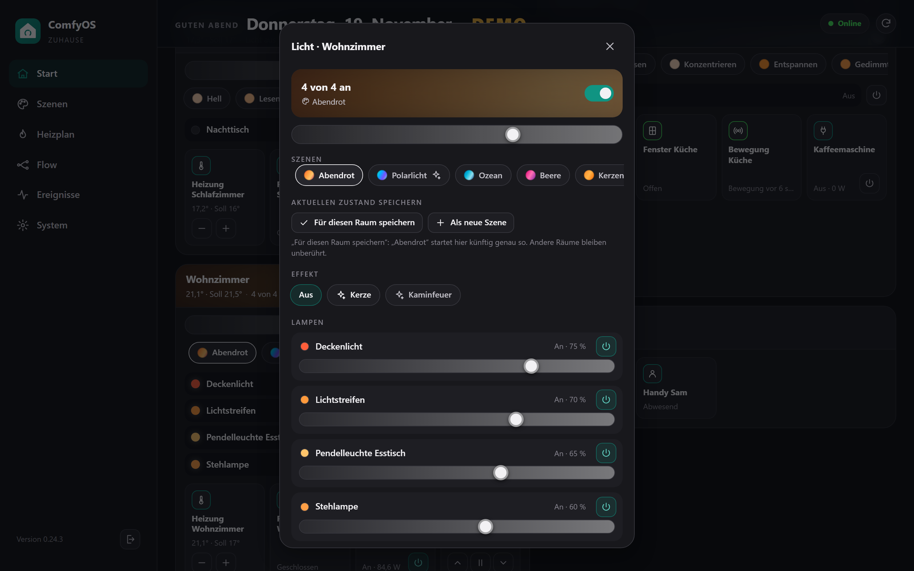
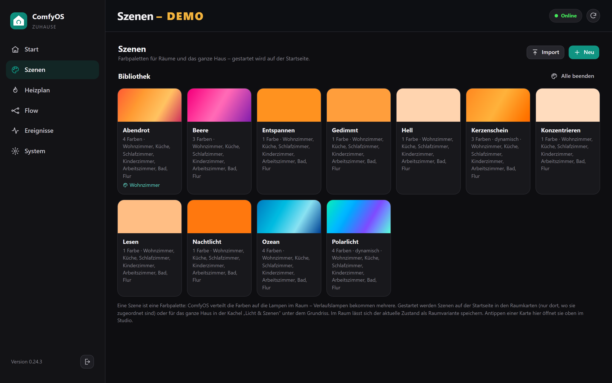

# Licht und Szenen

## Lampen schalten

- **Raumkarte:** ein Schalter und ein Helligkeitsregler für alle Lampen des Raums, darunter jede Lampe einzeln.
- **Alle Lichter an/aus** unter dem Grundriss. Steckdosen bleiben dabei unberührt.
- **Lichteinstellung des Raums:** Kopf der Raumkarte antippen. Hier stellst du jede Lampe einzeln ein, speicherst den aktuellen Zustand und wählst Effekte.

Was eine Lampe kann, zeigt ihr Menü: Weißton von warm bis kalt, Farbrad, bei Verlaufslampen (Lightstrip, Gradient) einzelne Segmente und Effekte wie Kerze, Kaminfeuer oder Prisma.

## Szenen

Eine Szene ist in ComfyOS eine **Farbpalette**, keine Liste fester Lampenwerte. ComfyOS verteilt die Farben auf die Lampen eines Raums. Verlaufslampen bekommen mehrere Farben, Lampen ohne Farbe den passenden Weißton. Darum passt eine Szene in jeden Raum, egal wie viele Lampen dort hängen.

| Aufgabe | So geht’s |
|---|---|
| Szene anlegen | *Szenen → Neu*: Farben wählen oder aus einem Foto übernehmen. Das Foto bleibt auf deinem Gerät. |
| Szene einem Raum geben | Im Szenen-Studio die Räume ankreuzen. Eine Szene erscheint nur in den Räumen, denen sie zugeordnet ist. |
| Szene starten | In der Raumkarte antippen, oder für das ganze Haus in „Licht & Szenen“. |
| Szene beenden | Die aktive Szene noch einmal antippen. Das Licht von vorher kommt zurück. |
| Für einen Raum anpassen | Szene starten, Lampen umstellen, **Für diesen Raum speichern**. Andere Räume bleiben unberührt. |
| Aus dem aktuellen Licht | **Als neue Szene** macht aus dem Licht eines Raums eine neue Palette. |
| Hue-Szenen übernehmen | *Szenen → Import → Von der Hue Bridge*. Danach Räume im Studio zuordnen. |

**Dynamische Szenen** lassen die Farben langsam durch die Lampen wandern. Lampen bleiben dabei jederzeit einzeln steuerbar: Stellst du eine um, lässt die Szene sie in Ruhe.

## Effekte

In der Lichteinstellung eines Raums wählst du einen Effekt für den ganzen Raum oder einzelne Lampen. Als Farbe dient die eigene der Lampe, die der Szene oder eine eigene, dazu ein Tempo. Ein Szenenwechsel lässt den Effekt weiterlaufen, „Raum aus“ beendet ihn.

## Gerätesperre

Im Gerätemenü **Gerät sperren**. Dann schaltet ComfyOS das Gerät nicht mehr: weder per Tippen noch per Flow, Szene, Effekt, „Alle Lichter“ oder Sprachassistent. Ein Schloss zeigt die Sperre auf Kachel, Lampenzeile und im Grundriss.

Praktisch etwa für die Steckdose des Kühlschranks oder die Lampe im Kinderzimmer, die abends niemand per Automation einschalten soll. Die Sperre gilt nur in ComfyOS: Wandschalter und Hersteller-Apps schalten weiter.
