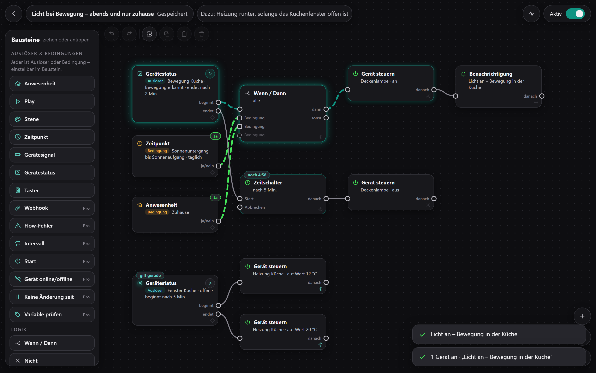

# Flow

Mit Flow baust du Automationen aus Bausteinen. Flows laufen in ComfyOS selbst, nicht in einer Cloud und nicht auf einer Bridge.



## Das Prinzip

Ein Flow verbindet Bausteine mit Linien:

- **Auslöser** starten einen Durchlauf: „Bewegung in der Küche“, „Sonnenuntergang“, „Taste 1 kurz gedrückt“.
- **Bedingungen** liefern Ja oder Nein: „ist es nach Sonnenuntergang?“, „ist jemand zu Hause?“.
- **Wenn / Dann** prüft beliebig viele Bedingungen (alle, mindestens eine oder genau eine) und verzweigt in „dann“ und „sonst“.
- **Aktionen** tun etwas: Gerät schalten, Szene starten, Heizroutine wechseln, benachrichtigen.

Viele Bausteine sind **Auslöser oder Bedingung**, je nach Einstellung. „Gerätestatus“ etwa startet einen Flow, wenn Bewegung erkannt wird – oder prüft als Bedingung, ob gerade Bewegung da ist.

## Zustände statt Momente

Zustands-Auslöser haben zwei Ausgänge: **beginnt** und **endet**. „Licht an, solange Bewegung da ist“ ist deshalb ein einziger Baustein:

```
Gerätestatus: Bewegung Küche, endet nach 2 Min.
   beginnt ──► Gerät steuern: Küchenlicht an
   endet   ──► Gerät steuern: Küchenlicht aus
```

ComfyOS merkt sich den Zustand, auch über einen Neustart. Nichts wird verpasst, nichts doppelt ausgelöst. Mit „beginnt nach“ und „endet nach“ muss ein Zustand eine Weile anhalten, etwa „Fenster länger als 5 Minuten offen“.

## Die Bausteine

| | Basic | Pro |
|---|---|---|
| **Auslöser und Bedingungen** | Anwesenheit, Play-Knopf, Szene, Zeitpunkt (Uhrzeit oder Sonnenauf-/-untergang mit Versatz), Gerätesignal (Batterie, Fehler, Alarm), Gerätestatus, Taster | Webhook, Flow-Fehler, Intervall, Start von ComfyOS, Gerät online/offline, Keine Änderung seit, Variable prüfen |
| **Logik** | Wenn / Dann, Nicht | Zufall, Drosseln/Entprellen, Umschalter, Solange, Haltezeit |
| **Aktionen** | Anwesenheit setzen, Szene, Gerät steuern, Wiedergabe, Heizroutine, Zeitschalter | HTTP-Aufruf, Flow an/aus, Variable setzen, Inspektor, Gerät sperren, Benachrichtigung |

Welche Eigenschaften „Gerätestatus“ anbietet, hängt von den gewählten Geräten ab: Bewegung, offen, Temperatur, an/aus, Helligkeit, Umgebungslicht in Lux, Wiedergabe und mehr. Auch Räume und Gerätegruppen lassen sich wählen.

## Testen und verstehen

- Jeder Auslöser hat einen **▶-Knopf**. Er startet einen Probedurchlauf.
- Der Weg eines Durchlaufs **leuchtet auf**. Bedingungen zeigen Ja oder Nein, wartende Bausteine zählen herunter.
- Der letzte Durchlauf lässt sich noch einmal abspielen.
- In der Flow-Liste leuchtet ein Flow kurz auf, wenn er auslöst.

## Bedienung

- Bausteine aus der linken Leiste ziehen oder antippen.
- Mehrfachauswahl mit Rahmen, Kopieren und Einfügen (auch zwischen Flows), Rückgängig/Wiederholen.
- Ein Zahnrad an einem Baustein zeigt, dass er Einstellungen hat, die auf der Karte nicht zu sehen sind.
- Flows lassen sich in Gruppen ordnen und verschieben.
- **Import/Export als JSON.** So kann auch eine KI einen Flow für dich entwerfen.

Zeitschalter und Schleifen blockieren nichts und überleben einen Neustart.

## Beispiele

| Ziel | Aufbau |
|---|---|
| Flurlicht nachts bei Bewegung | Gerätestatus „Bewegung Flur“ (Auslöser) → Wenn/Dann mit Zeitpunkt „Sonnenuntergang bis Sonnenaufgang“ → Flurlicht an. „endet“ → Flurlicht aus. |
| Heizung runter beim Lüften | Gerätestatus „Fenster Küche offen, beginnt nach 5 Min.“ → Heizung Küche 12 °C. „endet“ → 20 °C. |
| Wandtaster | Taster „Taste An, kurz“ → Licht im Wohnzimmer an. „Taste Aus, kurz“ → aus. |
| Alle weg | Anwesenheit „Abwesend“ (Auslöser) → Gerät steuern: alle Lampen aus → Wiedergabe: pausieren. |
| Handy kommt heim | Gerätestatus „Handy Alex anwesend“ (Auslöser) → Anwesenheit setzen: Zuhause. |
| Batterie-Hinweis (Pro) | Gerätesignal „Batterie schwach“ → Benachrichtigung aufs Handy. |

## Benachrichtigungen (Pro)

Der Baustein **Benachrichtigung** schreibt ins Ereignisprotokoll, zeigt einen Hinweis in der App und schickt auf Wunsch eine Push-Nachricht aufs Handy – auch wenn ComfyOS nicht geöffnet ist. Einrichten unter *System → Benachrichtigungen*, je Gerät. Push braucht HTTPS. Auf iPhone und iPad muss ComfyOS zum Home-Bildschirm hinzugefügt sein.
