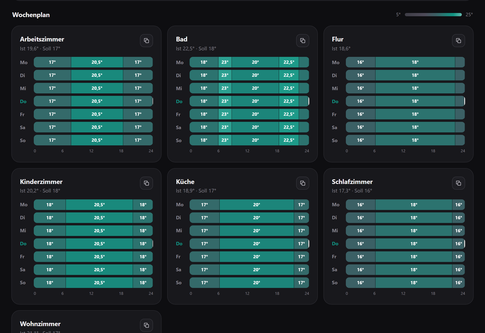

# Heizung und Energie

## Heizplan

Unter **Heizplan** legst du Heizroutinen an. Eine Routine ist ein Wochenplan je Raum, dargestellt als Zeitleisten.

- **Schaltpunkte** setzen: Uhrzeit und Temperatur, mit Schnellwahl Komfort, Standard, Eco und Aus.
- **Übertragen:** einen Tag auf andere Tage, einen Raum auf andere Räume kopieren.
- **Mehrere Routinen**, etwa „Winter“, „Übergang“ und „Urlaub“. Es gilt immer die aktive. Routinen lassen sich duplizieren.
- **Import/Export als JSON.** Räume werden per Name zugeordnet, mit Vorschau. Ein kopierbarer KI-Prompt hilft, einen Plan von einer KI entwerfen zu lassen.

**ComfyOS führt den Plan selbst aus.** Zu jedem Schaltpunkt bekommen alle Thermostate im Raum ihre Solltemperatur, egal ob sie an FRITZ!Box, Zigbee2MQTT oder Home Base hängen. Von Hand Verstelltes gilt bis zum nächsten Schaltpunkt.

Mit eingerichtetem **Magenta-Sync** heizt die Home Base ihre eigenen Thermostate selbst, ComfyOS übernimmt nur die übrigen. So kommen sich beide nie in die Quere.

## Zuhause und Abwesend

Der Schalter unter dem Grundriss gilt für das ganze Haus. Unter *System → Einstellungen → Zuhause / Abwesend* legst du fest, welche Heizroutine jeweils gilt. Flows können den Schalter setzen (Baustein „Anwesenheit setzen“) und auf ihn reagieren. Zusammen mit der Anwesenheit über FRITZ!Box oder das Netzwerk-Plugin schaltet ComfyOS so von selbst um.

## Temperatur- und Heizverlauf

Auf der Seite Heizplan zeigt ein Diagramm Ist- und Solltemperatur je Raum über 24 Stunden oder 7 Tage. Darunter liegt eine Spur für das Heizkörperventil: wann es offen war und wie weit. Meldet ein Thermostat keine Ventilstellung, zeigt die Spur schraffiert den Heizbedarf (Soll über Ist).

ComfyOS zeichnet dafür selbst alle fünf Minuten auf. Die Home Base speichert keinen Verlauf.

## Stromverbrauch

Unter dem Grundriss zeigt eine Kachel, was gerade im Haus verbraucht wird und wie viel heute zusammengekommen ist. Gezählt wird jedes Gerät, das selbst misst, also Zwischenstecker und Zähler.

Antippen öffnet die Details:

- **Leistung jetzt**, **Verbrauch seit** einem selbst gewählten Datum (zurücksetzbar) und **heute**.
- Jedes Messgerät mit Watt und Verbrauch.
- Mit Pro: Verlauf über 24 Stunden, 7 oder 31 Tage, als Summe oder je Gerät, dazu ein CSV-Export.

Geräte mit Zähler rechnen exakt. Meldet ein Gerät nur die Leistung, schätzt ComfyOS den Verbrauch und kennzeichnet ihn mit „≈“. Zeiten, in denen ComfyOS aus war, zählen nicht.

## Ereignisse

Die Seite **Ereignisse** listet, was passiert ist: Fenster, Batterie, Verbindungen, Befehle, Flows, Heizplan. Das Protokoll lässt sich exportieren und löschen.
